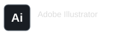
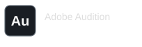

---

### 01 / ABOUT

Developer of game mods, small software tools, and 3D and audio projects.  
My work ranges from Lua scripting to modeling, texturing, sound design, and video editing.

---

### 02 / CURRENT FOCUS

- **Game modding:** Lua scripts and gameplay systems.
- **3D and media:** Models, textures, music, sound, and video.
- **Software:** Small utilities, automations.

---

### 03 / SOFTWARE

---

### 04 / GITHUB STATISTICS

---

### 05 / CONTACT

  &nbsp;&nbsp;
  &nbsp;&nbsp;
  

Discord · <code>nowheremarius</code>

---

MARIUS1337 &nbsp;&nbsp; / &nbsp;&nbsp; END OF PROFILE — 001

