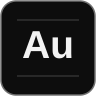

---

### 01 / ABOUT

Independent creator focused on software, automation, game systems, and digital production.  
Working across 3D modeling, sound design, visual media, and experimental tools.

---

### 02 / CURRENT FOCUS

<table>
<tr>
<td width="33%" valign="top">01 / GAME SYSTEMS <b>Simulation & Modding</b> Interactive systems, custom content, and technical experimentation.</td>
<td width="33%" valign="top">02 / DIGITAL MEDIA <b>3D, Audio & Visuals</b> Modeling, sound production, graphics, and motion.</td>
<td width="33%" valign="top">03 / AUTOMATION <b>Tools & Integrations</b> Utility software, workflows, and LLM tooling.</td>
</tr>
</table>

---

### 03 / SOFTWARE

<table>
<tr>
<td align="center" valign="middle"> Blender</td>
<td align="center" valign="middle"> Adobe Audition</td>
<td align="center" valign="middle"> Adobe Photoshop</td>
<td align="center" valign="middle"> VEGAS Pro</td>
<td align="center" valign="middle"> FL Studio</td>
<td align="center" valign="middle"> MagicaVoxel</td>
<td align="center" valign="middle"> Source Filmmaker</td>
</tr>
</table>

---

### 04 / GITHUB STATISTICS

&nbsp;

---

### 05 / ACTIVITY

Contribution calendar and activity history are also available below this README on GitHub.

---

### 06 / CONTACT

&nbsp;&nbsp; <a href="https://t.me/marius1337">Telegram</a> &nbsp;&nbsp;&nbsp;·&nbsp;&nbsp;&nbsp; &nbsp;&nbsp; Discord: `@nowheremarius` &nbsp;&nbsp;&nbsp;·&nbsp;&nbsp;&nbsp; &nbsp;&nbsp; <a href="https://vk.ru/nowheremarius">VK</a> &nbsp;&nbsp;&nbsp;·&nbsp;&nbsp;&nbsp; &nbsp;&nbsp; <a href="https://github.com/nowheremarius">GitHub</a>

---

MARIUS1337 &nbsp;&nbsp; / &nbsp;&nbsp; END OF PROFILE — 001

